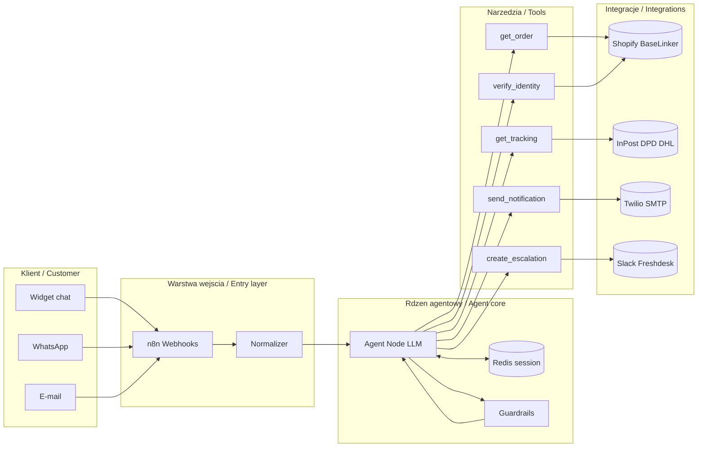
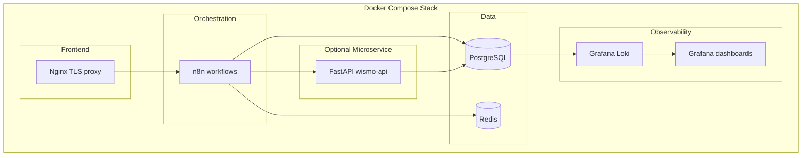

<div align="center">


# WISMO Agent
### AI Customer Service Automation for E-commerce

**Redukcja zgłoszeń "Gdzie moja paczka?" o 35 do 50 procent w 14 dni.**
**Cut "Where Is My Order?" tickets by 35 to 50 percent in 14 days.**

<br>

[](https://github.com/grzybowski-it/wismo-agent/actions/workflows/ci.yml)
[](https://codecov.io/gh/grzybowski-it/wismo-agent)
[](LICENSE)
[](https://github.com/grzybowski-it/wismo-agent/releases)
[](https://github.com/grzybowski-it/wismo-agent/discussions)
[](https://codespaces.new/grzybowski-it/wismo-agent)

<br>

[](https://www.docker.com/)
[](https://n8n.io/)
[](https://www.anthropic.com/)
[](https://fastapi.tiangolo.com/)
[](https://www.postgresql.org/)
[](https://redis.io/)

<br>

[Polski](#-polski) • [English](#-english) • [Architecture](docs/ARCHITECTURE.md) • [Quick Start](#-quick-start) • [ADRs](docs/adr/) • [Contributing](CONTRIBUTING.md) • [Security](SECURITY.md)

<br>


<sub>Podgląd wizualnej prezentacji projektu. Pełna wersja: <a href="https://claude.ai/code/artifact/ee29def7-0999-4098-9571-49c9e68f6f1c">artifact</a>.</sub>

</div>

---

## 🇵🇱 Polski

> [!IMPORTANT]
> WISMO Agent to produkcyjny asystent AI dla działów obsługi klienta e-commerce. Automatyzuje 35 do 50 procent zapytań o status przesyłki, integruje się ze sklepem (Shopify, BaseLinker, WooCommerce) oraz przewoźnikami (InPost, DPD, DHL, Poczta Polska), a w sytuacjach brzegowych bezpiecznie przekazuje wątek człowiekowi ze pełnym kontekstem.

### ✨ Wartość biznesowa

<table>
<tr>
<td width="33%" align="center">

**📉 Deflekcja zgłoszeń**
<br><br>
**35 do 50 procent**
<br><br>
zapytań WISMO obsługiwanych bez udziału konsultanta

</td>
<td width="33%" align="center">

**⚡ Czas odpowiedzi**
<br><br>
**Poniżej 5 sekund**
<br><br>
zamiast średnio 47 minut w klasycznym CS

</td>
<td width="33%" align="center">

**💰 Koszt na ticket**
<br><br>
**Poniżej 0,15 EUR**
<br><br>
zamiast około 3,50 EUR w klasycznym modelu

</td>
</tr>
</table>

### 🎯 Dla kogo

| Segment sklepu | Miesięczne zamówienia | Oczekiwana oszczędność miesięczna |
|---------------|------------------------|-------------------------------------|
| Mikro | 300 do 1 000 | 1 500 do 4 000 PLN |
| Mały | 1 000 do 5 000 | 4 000 do 12 000 PLN |
| Średni | 5 000 do 25 000 | 12 000 do 45 000 PLN |
| Duży | Powyżej 25 000 | Powyżej 45 000 PLN |

### 🧩 Co dostajesz

1. Repozytorium gotowe do uruchomienia jednym poleceniem `docker compose up -d`.
2. Cztery workflowy n8n w formacie JSON, w pełni skonfigurowane.
3. Kolekcję Bruno do testowania API sklepu i przewoźnika.
4. Produkcyjny system prompt z guardrailami (weryfikacja tożsamości, PII, blacklist zwrotów, walidacja halucynacji).
5. Warstwę Human in the Loop z briefem JSON do Slacka lub Freshdesk.
6. Dashboard Grafana z 7 kluczowymi metrykami produkcyjnymi.
7. Dokumentację produkcyjną w PL i EN.

<details>
<summary><b>📖 Pełna lista funkcji (kliknij żeby rozwinąć)</b></summary>

1. Trzy kanały wejściowe: widget WWW, WhatsApp Business API, e-mail (IMAP).
2. Weryfikacja tożsamości dwuetapowa (numer zamówienia plus e-mail lub telefon).
3. 10 zdefiniowanych scenariuszy brzegowych z decyzjami agenta.
4. Rozpoznawanie języka klienta (PL i EN out of the box).
5. Pamięć sesji w Redis, TTL 24 godziny.
6. Fallback modelu LLM (Claude Sonnet plus GPT-4o mini jako backup).
7. Rate limiting na poziomie kanału i sesji.
8. Audit log wszystkich rozmów w Postgres z pełnym trace narzędzi.
9. Redakcja PII (numery kart, PESEL) przed wysłaniem do LLM.
10. Proaktywne powiadomienia o opóźnieniach (workflow cronowy).
11. Wielotenancy (jedno wdrożenie może obsługiwać wielu klientów).
12. Multi-currency i multi-language ready.

</details>

### 🔗 Powiązania

> [!TIP]
> Ten moduł jest częścią większej matrycy usług "Automatyzacja e-commerce". Zobacz też: **AI Odzyskiwanie Koszyków**, **AI Generator Opisów**, **Real-time Omnichannel Stock Sync** oraz **Samoobsługowy Portal Zwrotów**.

---

## 🇬🇧 English

> [!IMPORTANT]
> WISMO Agent is a production ready AI customer service assistant for e-commerce. It automates 35 to 50 percent of "Where Is My Order?" inquiries, integrates with your store (Shopify, BaseLinker, WooCommerce) and carriers (InPost, DPD, DHL, Poczta Polska), and safely hands over edge cases to human agents with full conversational context.

### ✨ Business value

<table>
<tr>
<td width="33%" align="center">

**📉 Ticket deflection**
<br><br>
**35 to 50 percent**
<br><br>
of WISMO tickets handled without a human agent

</td>
<td width="33%" align="center">

**⚡ First response time**
<br><br>
**Under 5 seconds**
<br><br>
compared to 47 minutes average in classic CS

</td>
<td width="33%" align="center">

**💰 Cost per ticket**
<br><br>
**Below 0.15 EUR**
<br><br>
compared to around 3.50 EUR in classic model

</td>
</tr>
</table>

### 🎯 Who it is for

| Store segment | Monthly orders | Expected monthly savings |
|---------------|----------------|--------------------------|
| Micro | 300 to 1,000 | 300 to 900 EUR |
| Small | 1,000 to 5,000 | 900 to 2,700 EUR |
| Medium | 5,000 to 25,000 | 2,700 to 10,000 EUR |
| Large | Above 25,000 | Above 10,000 EUR |

### 🧩 What you get

1. A repository ready to launch with a single `docker compose up -d`.
2. Four fully configured n8n workflows in JSON.
3. A Bruno collection for testing store and carrier APIs.
4. Production system prompt with guardrails (identity verification, PII redaction, blacklist enforcement, hallucination checks).
5. Human in the Loop layer with structured JSON brief to Slack or Freshdesk.
6. Grafana dashboard with 7 key production metrics.
7. Production documentation in Polish and English.

<details>
<summary><b>📖 Full feature list (click to expand)</b></summary>

1. Three inbound channels: web widget, WhatsApp Business API, email (IMAP).
2. Two step identity verification (order number plus email or phone).
3. 10 defined edge case scenarios with predefined agent decisions.
4. Customer language detection (Polish and English out of the box).
5. Session memory in Redis with 24 hour TTL.
6. LLM model fallback (Claude Sonnet primary, GPT-4o mini backup).
7. Channel and session level rate limiting.
8. Full audit log of every conversation in Postgres with tool trace.
9. PII redaction (card numbers, national IDs) before LLM call.
10. Proactive delay notifications (cron workflow).
11. Multi tenant ready (single deployment can serve multiple stores).
12. Multi currency and multi language ready.

</details>

---

## 🏗 Architektura / Architecture



<details>
<summary><b>🔍 Rozbudowany diagram komponentów (kliknij żeby rozwinąć)</b></summary>



</details>

---

## 🚀 Quick Start

> [!NOTE]
> Kompletne uruchomienie lokalne wymaga: Docker Desktop, kluczy API do Shopify/BaseLinker, klucza Anthropic lub OpenAI, opcjonalnie klucza Twilio dla WhatsApp.
> Full local run requires: Docker Desktop, Shopify/BaseLinker API keys, Anthropic or OpenAI key, optionally Twilio key for WhatsApp.

### Krok 1. Sklonuj repo / Clone the repo

```bash
git clone https://github.com/grzybowski-it/wismo-agent.git
cd wismo-agent
cp docker/.env.example docker/.env
```

### Krok 2. Uzupełnij zmienne / Fill in variables

```bash
# Otwórz plik .env w edytorze i uzupełnij minimum:
# ANTHROPIC_API_KEY, SHOPIFY_STORE, SHOPIFY_ADMIN_TOKEN, N8N_ENCRYPTION_KEY
${EDITOR:-nano} docker/.env
```

### Krok 3. Uruchom stack / Start the stack

```bash
cd docker
docker compose up -d
```

Po 30 sekundach panel n8n będzie dostępny pod `http://localhost:5678`. Zaloguj się (dane w `.env`), zaimportuj workflowy z `n8n-workflows/*.json` i podłącz credentials.

After 30 seconds the n8n panel is available at `http://localhost:5678`. Log in (credentials in `.env`), import workflows from `n8n-workflows/*.json` and attach credentials.

### Krok 4 (opcjonalny). Testy Bruno / Optional Bruno tests

```bash
# Zainstaluj Bruno CLI / Install Bruno CLI
npm install -g @usebruno/cli

# Uruchom całą kolekcję / Run the full collection
cd bruno-collection
bru run --env local
```

---

## 🧠 System Prompt i Guardrails

<details>
<summary><b>📜 Kluczowe zasady system promptu (kliknij żeby rozwinąć)</b></summary>

1. Weryfikacja tożsamości obowiązkowa przed wywołaniem `get_order`.
2. Nie ujawniaj co jest w bazie. Nie mów "e-mail w naszym systemie to X".
3. Nie obiecuj zwrotów, rabatów, rekompensat. Kieruj do eskalacji.
4. Nie zgaduj godziny doręczenia. Podawaj przedziały z SLA przewoźnika.
5. Nie zmieniaj adresu dostawy sam. Kieruj do eskalacji.
6. Empatia i deeskalacja przed konkretem, jeśli klient sfrustrowany.
7. Maksymalnie 6 wywołań narzędzi w jednej turze.

Pełny prompt: [`src/prompts/system_prompt.md`](src/prompts/system_prompt.md).

</details>

<details>
<summary><b>🛡 Guardrails na wyjściu (kliknij żeby rozwinąć)</b></summary>

1. Długość odpowiedzi (max 800 znaków widget, 1000 WhatsApp, 2000 e mail).
2. Blacklist zwrotów: "gwarantuję", "na pewno", "obiecuję", "zwrot pieniędzy".
3. Wykrywanie halucynowanych numerów zamówień (walidacja z narzędzi).
4. Redakcja PII (numery kart, PESEL).
5. Wykrywanie tonu agresywnego lub kryzysowego, automatyczna eskalacja.

Implementacja: [`src/api/services/guardrails.py`](src/api/services/guardrails.py).

</details>

---

## 🤝 Human in the Loop

> [!TIP]
> Kiedy agent nie może rozwiązać sprawy, generuje ustrukturyzowany brief JSON i pushuje go do Slacka lub Freshdesk. Konsultant przejmujący widzi pełną transkrypcję i sugerowaną następną akcję.

Przykładowy brief w Slacku:

```
🚨 Eskalacja High
Klient: Anna Kowalska (a.kowalska@example.com)
Zamówienie: 12345, wartość 349 PLN
Powód: E05_delivered_not_received
Ostatni skan: 2026-09-08 12:04, InPost, "Delivered_to_locker"
Kontekst: Klient odebrał kod SMS, po otwarciu skrytki znalazł ją pustą (3 zdjęcia).
Sugerowana akcja: Zgłoszenie do InPost, tymczasowy kod 20 procent.

[Przejmuję]  [Zamknij bez akcji]  [Odsyłam do agenta]
```

---

## 📊 Metryki produkcyjne / Production metrics

| Metryka / Metric | Cel / Target | Alarm |
|-------------------|--------------|-------|
| Deflection rate | 35 do 50 procent | poniżej 25 procent przez 3 dni |
| First response time | poniżej 5s | powyżej 15s |
| Cost per session | poniżej 0,05 USD | powyżej 0,15 USD |
| CSAT | powyżej 4,2 / 5 | poniżej 3,8 / 5 |
| Halucynacje | poniżej 1 procent | powyżej 3 procent |
| P95 latency | poniżej 8s | powyżej 15s |

---

## 🗂 Struktura repozytorium / Repository structure

```
wismo-agent/
├── docker/                 # docker compose plus konfiguracja Nginx
├── n8n-workflows/          # 4 workflowy JSON gotowe do importu
├── bruno-collection/       # Testy API (Shopify, InPost, n8n webhooks)
├── src/
│   ├── api/                # Opcjonalny mikroserwis FastAPI (guardrails)
│   └── prompts/            # System prompt i pomocnicze
├── docs/                   # Architecture, deployment, prompts
├── skills/                 # Skille Claude Code (np. wismo-agent skill)
└── .github/workflows/      # CI, docker publish
```

---

## 🧪 Testowanie / Testing

```bash
# Testy Python (FastAPI, guardrails)
cd src
pip install -r requirements-dev.txt
pytest tests/ -v --cov=api --cov-report=term-missing

# Testy Bruno (endpointy API i webhooki)
cd bruno-collection
bru run --env local

# Testy end to end (Playwright)
cd tests/e2e
npm ci
npx playwright test
```

---

## 🚢 Deployment

> [!WARNING]
> Nie używaj domyślnych haseł w `.env.example` na produkcji. Wygeneruj `N8N_ENCRYPTION_KEY` przez `openssl rand -hex 32`. Nigdy nie commituj `.env` do repo.

### Zalecane hostingi:
1. **Coolify** (self hosted PaaS na własnym VPS)
2. **Railway** (managed, dobry na start)
3. **Hetzner Cloud + Docker** (najlepszy stosunek cena/wydajność w EU)
4. **AWS ECS + RDS** (dla korporacji)

Pełna instrukcja: [`docs/DEPLOYMENT.md`](docs/DEPLOYMENT.md).

---

## 🔒 Bezpieczeństwo / Security

> [!IMPORTANT]
> Warstwa security jest wpisana w architekturę, nie doklejona po fakcie.

**W repo od dnia zero:**

1. Guardrails po stronie serwera (blacklist zwrotów, PII redaction, walidacja halucynacji, limity długości). Testowane 27 testami pytest.
2. Weryfikacja tożsamości dwuetapowa przed dostępem do zamówienia.
3. Rate limiting per IP w Nginx (widget 30 rpm, api 120 rpm).
4. Security headers (X Frame Options, Referrer Policy, Permissions Policy).
5. Non root user w kontenerze wismo-api.
6. Postgres z scram-sha-256.
7. Gitleaks w CI (nie przepuszcza commitów z sekretami).
8. N8N_ENCRYPTION_KEY generowany losowo w `make init`.

**Do dopisania przed pierwszym realnym klientem:**

1. Prompt injection defense (Rebuff, LLM Guard albo własny klasyfikator).
2. Webhook signature verification (Shopify HMAC, Twilio signature).
3. Secrets management (Doppler, HashiCorp Vault, AWS Secrets Manager).
4. LLM cost limits per klient plus alerty.
5. Immutable audit log (S3 Object Lock).
6. RODO endpointy (prawo do bycia zapomnianym, retention 90 dni).
7. Dependency scanning (Dependabot, Trivy dla obrazów).

---

## 🧑‍💻 Contributing

1. Fork, branch feature/nazwa, PR do main.
2. Konwencja commitów: [Conventional Commits](https://www.conventionalcommits.org).
3. Wszystkie PR wymagają zielonego CI i review co najmniej jednej osoby.
4. Dodawaj testy do zmian w `src/`.

---

## 🎬 YouTube playbook

Pełny scenariusz nagrania filmu (format 15 minut speedrun plus format 5 odcinkowego devlogu) znajduje się w [`docs/RECORDING.md`](docs/RECORDING.md). Zawiera dokładny timeline, listę rekwizytów, checklistę dnia nagrania i propozycje miniatury.

---

## 🗺 Roadmap

- [x] MVP: widget plus n8n plus Shopify plus InPost
- [x] WhatsApp Business API
- [x] E-mail (IMAP)
- [x] Guardrails i PII redaction
- [x] HITL Slack integration
- [ ] Freshdesk i Zendesk connectors
- [ ] Multi tenant panel admin
- [ ] BaseLinker native integration (obecnie przez webhook)
- [ ] Voice channel (Twilio Voice plus TTS/STT)
- [ ] Analytics w produkcie (Metabase embedded)

---

## 📜 License

MIT. Zobacz [LICENSE](LICENSE).

---

## 👤 Autor / Author

**Hubert Grzybowski**
[grzybowski.it@gmail.com](mailto:grzybowski.it@gmail.com) • [GitHub](https://github.com/grzybowski-it)

Rozwiązania AI dla e-commerce. Automatyzacja obsługi klienta, odzyskiwanie koszyków, generowanie opisów, orkiestracja OMS.
AI solutions for e-commerce. Customer service automation, cart recovery, product content generation, OMS orchestration.

---

<div align="center">

**Zbudowane z myślą o produkcji, nie o demo.**
**Built for production, not for demos.**

⭐ Jeśli ten projekt Ci się przyda, zostaw gwiazdkę. / If this project helps you, drop a star.

</div>
