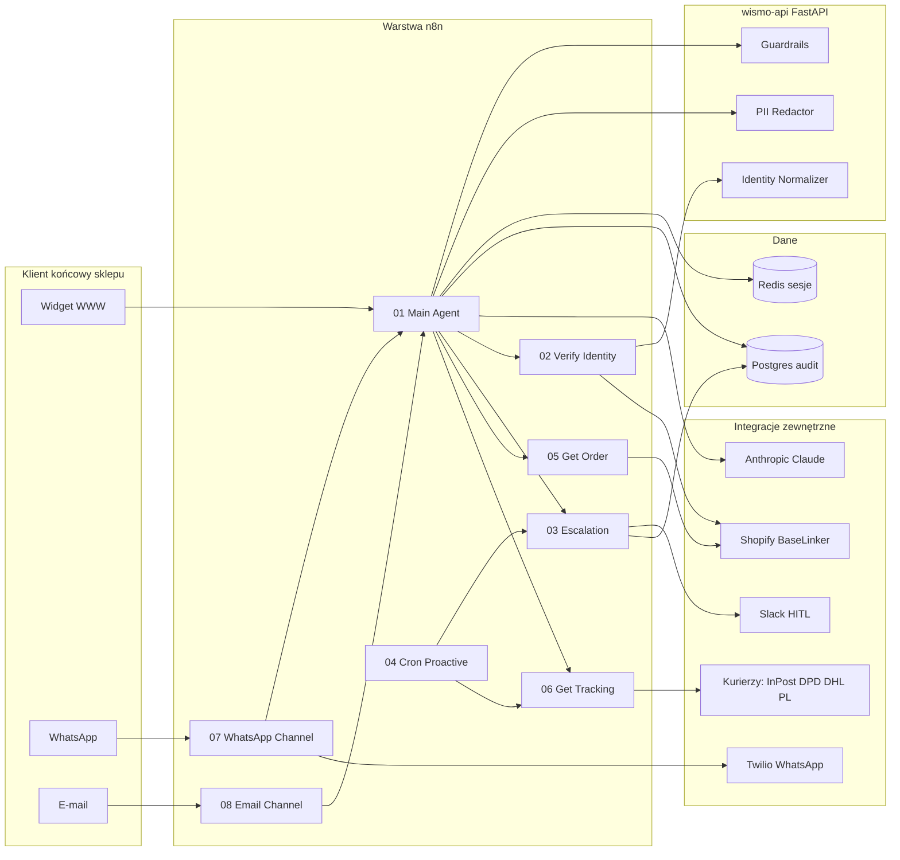

# Architektura

Kompletny opis systemu z perspektywy inżyniera który wchodzi na projekt.

## Big picture



## Warstwy

### 1. Kanały wejściowe

Trzy kanały, każdy z osobnym workflow, wszystkie delegują do jednego `01_main_agent`.

| Kanał | Trigger | Session ID | Latencja oczekiwana |
|-------|---------|------------|--------------------|
| Widget WWW | Webhook POST | random z frontendu | 2 do 5 sekund |
| WhatsApp | Twilio webhook | numer telefonu | 5 do 15 sekund |
| E-mail | IMAP polling | address plus timestamp | 5 do 15 minut |

Kanały mogą się dodawać (Instagram DM, Messenger, SMS, głos przez Twilio Voice). Zasada: kanał robi tylko transport i formatowanie, cała logika jest w `01`.

### 2. Rdzeń agentowy (n8n 01)

Sekwencja 9 kroków. Każdy krok jest osobnym węzłem z jasną odpowiedzialnością.

1. **Webhook** przyjmuje żądanie.
2. **Normalizer** ujednolica payload.
3. **PII Redactor** wywołuje wismo-api żeby zamaskować numery kart i PESEL zanim tekst dotknie LLM.
4. **Session Loader** czyta stan sesji z Redis (historia, kontekst zamówienia jeśli już zidentyfikowane).
5. **Agent LLM** Claude Sonnet z Tool Calling do 5 narzędzi.
6. **Guardrails** wismo-api sprawdza czy odpowiedź nie łamie reguł.
7. **Session Saver** zapisuje sesję z TTL 24h.
8. **Audit Log** insert do Postgres.
9. **Respond** JSON do kanału.

### 3. Tools (n8n sub workflows)

Agent LLM widzi 5 narzędzi. Każde to osobny sub workflow, wywoływany przez `executeWorkflow` node z JSON Schema kontrolującym input.

```
verify_identity  → 02_verify_identity
get_order        → 05_tool_get_order
get_tracking     → 06_tool_get_tracking
create_escalation → 03_escalation_handler
send_notification → (do dobudowania w 09_tool_send_notification)
```

Każdy sub workflow:

1. Trigger `executeWorkflowTrigger` z inputami zgodnymi z JSON Schema.
2. Wywołanie zewnętrznego API (retry 3x, backoff 1s/2s/4s, timeout 5s).
3. Normalizacja odpowiedzi do wspólnego formatu wewnętrznego.
4. Error handler: strukturalny `{ error, retriable }` przy 4xx/5xx.

### 4. Mikroserwis wismo-api (FastAPI)

Trzy odpowiedzialności które nie mieszczą się dobrze w n8n:

1. **Guardrails validation** (`POST /guardrails/validate`) walidacja długości, blacklist, halucynacji, PII w outputach.
2. **PII redaction** (`POST /guardrails/redact`) redakcja przed wysłaniem do LLM.
3. **Identity normalization** (`POST /identity/normalize`) normalizacja numeru zamówienia i e-maila, fuzzy matching.

Napisane w Pythonie 3.12 z FastAPI 0.115. 27 testów jednostkowych. Ruff do lintu. Dockerfile z non root userem.

Dlaczego nie w n8n? Bo logika testowalna, wersjonowalna w git, code review-alna, i zawiera regex które są trudne do utrzymania w Function Node.

### 5. Warstwa danych

**Redis**: pamięć sesji (klucz `session:{session_id}`, TTL 24h). LRU eviction przy przekroczeniu 512 MB. Wolatylne z założenia (klient może stracić sesję po restarcie, ale kontekst zamówienia da się odbudować z Postgres audit).

**Postgres 16**: dwie główne tabele.

1. `agent_conversations` audit log, po jednym rekordzie per turn (user_message, agent_msg, tools_used, latency, tokens, cost, guardrails_result, order_id, created_at).
2. `escalations` osobna tabela dla ticketów HITL z pełnym payloadem JSONB.

Plus widok `v_metrics_daily` dla Grafany.

### 6. Observability

**Grafana + Loki**: logi z n8n i wismo-api przez Docker log driver. Loki przechowuje 14 dni logów (konfigurowalne). Grafana z 7 dashboardami:

1. Deflection rate per dzień/kanał
2. Latencja P50/P95/P99
3. Koszt LLM per dzień
4. Kolejka nierozwiązanych eskalacji
5. Health checks
6. Error rate per Tool
7. Top 20 reason_codes eskalacji

**Health checks**: każda usługa w docker compose ma health check. Nginx expose'uje `/health` dla zewnętrznego monitoringu (Uptime Kuma, Better Stack).

### 7. Warstwa bezpieczeństwa

Nakłada się na wszystko powyżej.

1. **TLS** Nginx (na produkcji Caddy z auto Let's Encrypt).
2. **Rate limiting** per IP w Nginx (widget 30 rpm, api 120 rpm), plus per session w Redis (dodać w wismo-api).
3. **Guardrails** w wismo-api walidują KAŻDĄ odpowiedź LLM.
4. **PII redaction** przed LLM (redact) i po LLM (validate).
5. **Non root** w kontenerach.
6. **Secrets** w n8n z `N8N_ENCRYPTION_KEY`, w Postgres z scram-sha-256.
7. **Gitleaks** w CI, nie przepuszcza commitów z sekretami.
8. **Webhook signatures** Twilio X-Twilio-Signature, Shopify HMAC (dobudować w kanałach).

## Decyzje architektoniczne

### Dlaczego n8n a nie napisać workflow w Pythonie

1. Wizualna edycja dla klienta (część klientów chce sama zmienić prompt lub dodać krok).
2. Ekosystem integracji out of the box (Slack, Twilio, Shopify, IMAP, Postgres, Redis).
3. Historia executions, retry, monitoring w UI.
4. Krzywa uczenia się zespołu CS klienta niższa niż w kodzie.

Trade off: n8n Function Node są mniej testowalne niż moduł Pythona. Dlatego cała logika krytyczna (guardrails, walidacja) siedzi w wismo-api, nie w Function Node.

### Dlaczego Claude Sonnet a nie GPT-4o

1. Lepszy w Tool Use w benchmarkach 2026.
2. Naturalna polszczyzna out of the box.
3. Mniejsza tendencja do halucynacji w warstwie constrained instruction following.
4. Fallback do GPT-4o mini jest wpisany na wypadek outage.

### Dlaczego Redis a nie tylko Postgres

Postgres dałby radę, ale Redis:

1. Latencja sub-millisekundowa dla load session przy każdej wiadomości.
2. TTL out of the box (Postgres wymagałby crona).
3. Publish/subscribe gdyby dodać real-time (np. presence w widget).
4. Broker BullMQ dla n8n queue mode.

### Dlaczego docker compose a nie Kubernetes

1. Prostota deploymentu i debugowania.
2. Klient ma jedno VPS, nie klaster.
3. Wystarcza do 100 000 sesji dziennie na jednym CX31.
4. Migracja na K8s trywialna gdy potrzeba (Helm chart wygenerowany z docker compose przez Kompose).

## Trade offs które warto znać

1. **Session w Redis jest wolatylna**. Utrata Redis = utrata otwartych rozmów. Ale kontekst zamówienia da się odbudować z Postgres audit log.
2. **n8n Community Edition ma limity**. Powyżej 50 concurrent executions rozważ Enterprise. Alternatywa: 2 n8n workery z BullMQ queue (już w compose).
3. **LLM koszty zmienne**. Musisz mieć twarde limity per klient (dobudować w wismo-api middleware), inaczej bot może wyczerpać budżet.
4. **Prompt injection**. Guardrails łapią większość, ale zaawansowany atak może przejść. Docelowo dodać klasyfikator (Rebuff, LLM Guard).

## Co dalej

1. Prompt injection defense (klasyfikator na wejściu).
2. Sub workflow `09_tool_send_notification` (SMS/email out-of-session).
3. Multi tenant: schemat DB per klient plus tenant middleware w wismo-api.
4. Voice channel przez Twilio Voice + TTS/STT.
5. Analytics w produkcie: Metabase embedded z dashboardami które klient widzi w swoim panelu.
