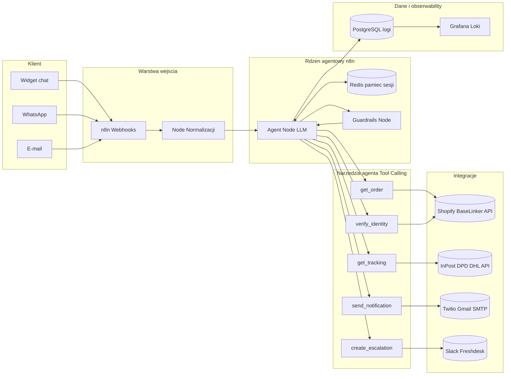

# Agent CS i Tracking WISMO
## Specyfikacja Architektury i Wdrożenia Produkcyjnego

> Wersja 1.0. Dokument techniczny dla modułu TIER 1 z matrycy usług "Automatyzacja e-commerce". Autor: Hubert Grzybowski.

## Streszczenie wykonawcze

Moduł Agent CS i Tracking WISMO automatyzuje obsługę zapytań typu "Gdzie jest moja paczka?", które stanowią 30 do 50 procent całego wolumenu zgłoszeń w typowym sklepie internetowym. Docelowa deflekcja zgłoszeń wynosi 35 do 50 procent, wdrożenie zajmuje od 1 do 2 tygodni w standardowym setupie (jeden kanał, jeden magazyn, jeden system OMS lub e-commerce), a zwrot z inwestycji następuje zwykle w pierwszym miesiącu produkcyjnym.

Rozwiązanie łączy orkiestrację workflow (n8n), agenta LLM z Tool Calling (Claude Sonnet lub OpenAI GPT), warstwę integracji z API sklepu (Shopify, BaseLinker, WooCommerce) i przewoźnika (InPost, DPD, DHL), cache statusów (Redis) oraz kolejkę Human in the Loop (Slack lub Freshdesk). Całość dostarczana jest jako repozytorium z `docker-compose`, kolekcją Bruno do testów API i produkcyjną dokumentacją README.

Kluczowe wskaźniki wpływu na biznes:
1. Redukcja MTTFR (Mean Time To First Response) z kilkudziesięciu minut do 5 sekund.
2. Redukcja kosztu obsługi pojedynczego ticketu WISMO z około 3,50 EUR do poniżej 0,15 EUR (koszt tokenów LLM plus infrastruktura).
3. Ograniczenie kolejki człowieka o 35 do 50 procent w pierwszych 30 dniach.
4. Odzyskanie 20 do 30 procent czasu zespołu CS na case'y wysokiej wartości (reklamacje, retencja, upsell).

---

# CZĘŚĆ A. Specyfikacja biznesowa i UX

## A.1. Architektura kanałów wejściowych

Agent obsługuje trzy kanały wejściowe w pierwszej fazie wdrożenia. Każdy kanał ma inny profil oczekiwań klienta co do czasu odpowiedzi i formatu.

| Kanał | Latencja oczekiwana | Format odpowiedzi | Uwierzytelnienie | Sesja |
|-------|--------------------|--------------------|-------------------|-------|
| Widget czatu na stronie | 2 do 5 sekund | Krótkie akapity, karty statusu, przyciski akcji | Cookie sklepu plus podanie numeru zamówienia | Efemeryczna, w localStorage |
| WhatsApp Business API | 5 do 15 sekund | Tekst plus szablony (List Messages, Interactive Buttons) | Numer telefonu z profilem klienta, MFA przez numer zamówienia | 24 godziny (session window Meta) |
| E-mail | 5 do 15 minut | Formatowana odpowiedź HTML z sygnaturą marki | Adres nadawcy plus numer zamówienia z treści lub tematu | Wątek IMAP oznaczony custom nagłówkiem |

## A.2. Happy Path. Scenariusz kanoniczny (widget)

Poniższy scenariusz opisuje przepływ dla najczęstszej sytuacji: klient chce sprawdzić status wysyłki dwa dni po złożeniu zamówienia.

1. Klient otwiera widget na stronie sklepu i pisze: "Gdzie jest moja paczka z zamówienia?"
2. Agent inicjuje sesję i pyta o dane weryfikacyjne. Jedno pytanie w jednej wiadomości, żeby nie tworzyć friction.
3. Klient podaje numer zamówienia (12345) oraz adres e-mail zakupu.
4. Agent wykonuje w tle następującą sekwencję (Tool Calling):
   1. `get_order_by_id(order_id=12345)` z Shopify lub BaseLinker.
   2. Walidacja zgodności e-maila (dopasowanie po `customer.email` z tolerancją na literówki).
   3. `get_shipment_tracking(tracking_number)` z API przewoźnika (InPost, DPD, DHL, Poczta Polska).
   4. `get_estimated_delivery_window(courier, shipment_status)` z lokalnej tabeli SLA per przewoźnik.
5. Agent zwraca strukturalną odpowiedź. Format wypunktowany, konkretny, bez pustych zwrotów grzecznościowych na początku.

Przykład finalnej odpowiedzi w kanale widget:

> Twoje zamówienie 12345 jest w drodze.
>
> Status: paczka w sortowni Warszawa Wschód, przewoźnik InPost.
> Ostatnia aktualizacja: dziś, 14:22.
> Przewidywana dostawa: jutro, 9 września, w godzinach 12:00 do 16:00.
> Sposób odbioru: Paczkomat WAW1234.
>
> Chcesz otrzymać powiadomienie SMS gdy paczka trafi do Paczkomatu?

Przyciski akcji: `Tak, powiadom mnie SMS`, `Zmień Paczkomat`, `Porozmawiaj z konsultantem`.

## A.3. Weryfikacja tożsamości. Wzór progressive disclosure

Weryfikacja odbywa się dwuetapowo, żeby nie tworzyć wrażenia formularza:

1. Etap identyfikacji: numer zamówienia. Agent akceptuje dowolny format (`#12345`, `12345`, `ORD 12345`, `zamówienie 12345`) i normalizuje regexem `\d{4,10}`.
2. Etap autoryzacji: adres e-mail lub cztery ostatnie cyfry numeru telefonu (fallback dla klientów gościnnych). Dopasowanie fuzzy z tolerancją Levenshteina 2 dla e-maila.

Jeżeli dane nie zgadzają się po dwóch próbach, agent przekazuje wątek do człowieka z informacją "Klient nie potwierdził tożsamości. Powód: e-mail niezgodny z rekordem." Nigdy nie ujawnia jaki e-mail jest w bazie.

## A.4. Scenariusze brzegowe (Edge Cases)

Poniższa tabela opisuje 10 najważniejszych scenariuszy brzegowych obserwowanych w praktyce sklepów w Polsce i EU. Każdy scenariusz ma zdefiniowaną decyzję agenta, komunikat oraz warunki eskalacji.

| ID | Sytuacja | Decyzja agenta | Komunikat do klienta (skrót) | Eskalacja HITL |
|----|----------|----------------|-------------------------------|----------------|
| E01 | Brak zamówienia w bazie | Pytaj o alternatywny numer, potem eskaluj | "Nie znajduję tego numeru. Sprawdź proszę, czy nie masz go w e mailu potwierdzającym." | Po 2 nieudanych próbach |
| E02 | Zamówienie znalezione, brak numeru listu przewozowego | Odpowiedz z etapu produkcji lub pakowania | "Paczka jest w przygotowaniu. List przewozowy zwykle nadajemy w ciągu 24 godzin." | Jeśli od statusu "Paid" minęło ponad 72 godziny |
| E03 | Status "Wysłano", brak update z kuriera przez 48h | Powiedz co wiesz, zaproponuj interwencję | "Ostatni skan był 2 dni temu w sortowni X. Otworzę zgłoszenie u przewoźnika." | Zawsze, automatyczne otwarcie ticketu u kuriera |
| E04 | Paczka opóźniona (dostawa po deklarowanej dacie) | Empatyczna informacja plus opcja rekompensaty | "Paczka jest opóźniona o 1 dzień z powodu opóźnień u kuriera. Proponuję kod rabatowy 15 procent." | Jeśli klient poprosi o zwrot pieniędzy |
| E05 | Paczka oznaczona jako doręczona, klient jej nie ma | Nie zgaduj, natychmiast eskaluj z kontekstem | "Widzę że kurier oznaczył paczkę jako doręczoną. To wymaga zajęcia się przez zespół, przekazuję sprawę." | Zawsze, priorytet High |
| E06 | Uszkodzenie paczki (klient zgłasza) | Zainicjuj protokół zwrotu | "Bardzo mi przykro. Otwieram procedurę reklamacyjną, wyślę na Twój e-mail formularz protokołu szkody." | Zawsze, priorytet Medium |
| E07 | Klient chce zmienić adres po wysyłce | Sprawdź feasibility u kuriera, nie obiecuj | "Sprawdzam u kuriera możliwość przekierowania. To zajmie do 10 minut." | Jeśli kurier nie wspiera API zmian |
| E08 | Klient chce anulować niewysłane zamówienie | Wykonaj anulację jeżeli status Paid i not Fulfilled | "Anulowałem zamówienie. Zwrot środków w 3 do 5 dni roboczych." | Jeśli fulfillment już rozpoczęty |
| E09 | Wielokrotne zapytania od tego samego klienta w krótkim czasie | Rozpoznaj kontekst, nie powtarzaj powitania | "Widzę że pytałeś o tę paczkę godzinę temu. Nowa informacja: paczka opuściła sortownię." | Jeśli klient wyraża frustrację |
| E10 | Klient agresywny lub w kryzysie emocjonalnym | Deeskaluj tonem, przekaż do człowieka bez opóźnień | "Rozumiem że to frustrujące. Przekazuję Twoją sprawę osobie z zespołu, będzie u Ciebie w ciągu 15 minut." | Zawsze, priorytet High |

## A.5. Human in the Loop. Struktura eskalacji

Kiedy agent przekazuje wątek człowiekowi, generuje ustrukturyzowany brief w formacie JSON i pushuje go do Slacka (lub Freshdesk, Zendesk, Intercom). Brief zawiera:

```json
{
  "escalation_id": "esc_2026_09_09_00042",
  "priority": "High",
  "reason_code": "E05_delivered_not_received",
  "customer": {
    "name": "Anna Kowalska",
    "channel": "widget",
    "email": "a.kowalska@example.com",
    "phone": "+48 600 111 222"
  },
  "order": {
    "id": "12345",
    "value_pln": 349.00,
    "items": 3,
    "shipping_method": "InPost Paczkomat"
  },
  "shipment": {
    "tracking": "660000123456",
    "carrier": "InPost",
    "last_scan": "2026-09-08 12:04",
    "last_status": "Delivered_to_locker"
  },
  "conversation_summary": "Klient odebrał kod SMS z Paczkomatu, po otwarciu skrytki znalazł ją pustą. Zdjęcia załączone (3).",
  "attachments": ["photo1.jpg", "photo2.jpg", "photo3.jpg"],
  "suggested_next_action": "Zgłoszenie do InPost przez formularz reklamacyjny, wysłanie klientowi tymczasowego kodu 20 procent."
}
```

Brief pojawia się w kanale Slacka `#cs-eskalacje` z przyciskami "Przejmuję", "Zamknij bez akcji", "Odsyłam do agenta". Konsultant przejmujący wątek widzi pełną transkrypcję rozmowy w wątku.

---

# CZĘŚĆ B. Architektura techniczna i tooling

## B.1. Diagram przepływu (Mermaid)



## B.2. Struktura repozytorium

```
wismo-agent/
├── docker/
│   ├── docker-compose.yml
│   ├── docker-compose.prod.yml
│   ├── .env.example
│   └── nginx/
│       └── nginx.conf
├── n8n-workflows/
│   ├── 01_main_agent.json
│   ├── 02_verify_identity.json
│   ├── 03_escalation_handler.json
│   ├── 04_proactive_delay_notifier.json
│   └── README.md
├── bruno-collection/
│   ├── bruno.json
│   ├── environments/
│   │   ├── local.bru
│   │   └── prod.bru
│   ├── Shopify/
│   │   ├── get_order.bru
│   │   └── list_orders.bru
│   ├── InPost/
│   │   └── get_tracking.bru
│   ├── n8n_webhooks/
│   │   ├── chat_webhook.bru
│   │   └── whatsapp_webhook.bru
│   └── README.md
├── src/
│   ├── api/
│   │   ├── main.py                # FastAPI opcjonalny mikroserwis
│   │   ├── routers/
│   │   │   ├── verify.py
│   │   │   └── health.py
│   │   ├── services/
│   │   │   ├── shopify.py
│   │   │   ├── inpost.py
│   │   │   └── guardrails.py
│   │   └── models/
│   ├── prompts/
│   │   ├── system_prompt.md
│   │   ├── verification_prompt.md
│   │   └── escalation_prompt.md
│   └── tests/
│       ├── test_verify.py
│       └── test_prompts.py
├── docs/
│   ├── ARCHITECTURE.md
│   ├── PROMPTS.md
│   ├── DEPLOYMENT.md
│   └── diagrams/
├── skills/
│   └── wismo-agent/
│       ├── SKILL.md
│       └── references/
├── .github/
│   ├── workflows/
│   │   ├── ci.yml
│   │   └── docker-publish.yml
│   └── ISSUE_TEMPLATE/
├── .gitignore
├── LICENSE
└── README.md
```

## B.3. Warstwa konteneryzacji

Konfiguracja `docker-compose.yml` uruchamia cały stack jednym poleceniem `docker compose up -d`. Zawiera pięć usług:

1. `n8n`: orkiestrator workflowów, port 5678.
2. `postgres`: baza dla n8n plus logi sesji, port 5432 (lokalnie), volume `pgdata`.
3. `redis`: cache sesji agenta i rate limiting, port 6379.
4. `wismo-api`: opcjonalny mikroserwis FastAPI do walidacji i guardraili, port 8000.
5. `nginx`: reverse proxy z TLS i rate limitingiem, porty 80 i 443.

Zmienne środowiskowe (przykładowe klucze w `.env.example`):

```env
# n8n
N8N_HOST=agent.mojsklep.pl
N8N_ENCRYPTION_KEY=CHANGE_ME_32_BYTES_MIN
N8N_BASIC_AUTH_ACTIVE=true
N8N_BASIC_AUTH_USER=admin
N8N_BASIC_AUTH_PASSWORD=CHANGE_ME

# Postgres
DB_POSTGRESDB_HOST=postgres
DB_POSTGRESDB_DATABASE=n8n
DB_POSTGRESDB_USER=n8n
DB_POSTGRESDB_PASSWORD=CHANGE_ME

# Redis
REDIS_URL=redis://redis:6379/0

# LLM
ANTHROPIC_API_KEY=sk-ant-...
OPENAI_API_KEY=sk-...
LLM_MODEL=claude-sonnet-5
LLM_FALLBACK_MODEL=gpt-4o-mini

# Sklep
SHOPIFY_STORE=mojsklep.myshopify.com
SHOPIFY_ADMIN_TOKEN=shpat_...
BASELINKER_TOKEN=

# Przewoznik
INPOST_API_TOKEN=
DPD_API_LOGIN=
DPD_API_PASSWORD=

# Kanaly
TWILIO_ACCOUNT_SID=
TWILIO_AUTH_TOKEN=
WHATSAPP_NUMBER=whatsapp:+48...
SLACK_ESCALATION_WEBHOOK=

# Guardrails
MAX_TOKENS_PER_SESSION=8000
MAX_TOOL_CALLS_PER_TURN=6
PII_REDACTION=true
```

## B.4. Kolekcja Bruno

Bruno służy do trzech celów:

1. Walidacja endpointów zewnętrznych API (Shopify, InPost) przed integracją w n8n.
2. Testy dymne po wdrożeniu (webhooki n8n odpowiadają poprawnie na payloady testowe).
3. Dokumentacja żywa. Każdy `.bru` jest requestem z opisem.

Przykład pliku `bruno-collection/InPost/get_tracking.bru`:

```
meta {
  name: Get shipment tracking
  type: http
  seq: 1
}

get {
  url: https://api-shipx-pl.easypack24.net/v1/tracking/{{tracking_number}}
  body: none
  auth: bearer
}

auth:bearer {
  token: {{INPOST_API_TOKEN}}
}

vars:pre-request {
  tracking_number: 660000123456
}

tests {
  test("status is 200", function() {
    expect(res.getStatus()).to.equal(200);
  });
  test("has tracking details", function() {
    expect(res.getBody()).to.have.property("tracking_number");
    expect(res.getBody()).to.have.property("status");
  });
}
```

## B.5. Claude Code i Vercel Skills. Rekomendowane moduły

Do przyspieszenia budowy tego projektu w Claude Code warto włączyć następujące skille (część natywnych, część do zainstalowania).

Natywne, już zainstalowane w tej sesji:
1. `naturalny-polski`: dbanie o poprawną polszczyznę w README i komunikatach dla klienta.
2. `docx`, `pdf`: generowanie dokumentacji ofertowej i regulaminów RODO dla klienta końcowego.
3. `web-artifacts-builder`: budowa demo widgetu chatu jako artifact do prezentacji sprzedażowej.
4. `skill-creator`: przygotowanie własnych skilli dla powtarzalnych elementów (np. skill generujący JSON workflow n8n z briefu).

Do instalacji przez `npx -y skills add`:
1. `vercel-labs/skills/n8n-workflow-builder`: generowanie szkieletów workflowów n8n z opisu.
2. `vercel-labs/skills/openapi-to-tools`: konwersja specyfikacji OpenAPI Shopify i InPost na definicje Tool Calling.
3. `vercel-labs/skills/bruno-collection-generator`: generowanie kolekcji Bruno z listy endpointów.
4. `vercel-labs/skills/mermaid-architect`: walidacja i renderowanie diagramów Mermaid.

MCP (Model Context Protocol), do włączenia w tej sesji lub Claude Code CLI:
1. MCP `n8n-mcp` (już dostępny w tej sesji): tworzenie i walidacja workflowów n8n bezpośrednio z LLM.
2. MCP `github`: automatyczne PR z gotowymi workflowami i README.
3. MCP `notion`: synchronizacja specyfikacji z dokumentacją oferty w Notion (link w kontekście projektu).
4. MCP `firecrawl`: scrapowanie dokumentacji Shopify/InPost do lokalnego kontekstu, gdyby fetch zawiódł.
5. MCP `supabase` (opcjonalnie): jeśli klient chce SaaS backend, alternatywa dla self hosted Postgres.

Rekomendacja praktyczna: w pierwszym tygodniu wdrożenia użyj n8n-mcp do wygenerowania i walidacji workflowów, GitHub MCP do automatycznego commita, oraz notion-mcp do zsynchronizowania specyfikacji z kartą klienta.

---

# CZĘŚĆ C. Produkcyjny kod i workflow (Blueprint)

## C.1. Struktura workflow n8n (główny agent)

Główny workflow `01_main_agent.json` składa się z następujących węzłów w kolejności wykonania:

1. **Webhook Trigger**: przyjmuje POST z kanału (widget/WhatsApp/e-mail). Payload zawiera `channel`, `session_id`, `user_message`, `metadata`.
2. **Normalizer Function**: normalizacja payloadu do wspólnego formatu wewnętrznego. Detekcja języka (`fastText` przez custom node lub prosty regex PL/EN).
3. **Session Loader Redis**: `GET session:{session_id}` z Redis. Ładuje historię rozmowy, stan weryfikacji, kontekst zamówienia jeżeli już zidentyfikowane.
4. **PII Redactor Function**: maskowanie potencjalnych numerów kart (regex `\b\d{13,19}\b`) w wiadomości wejściowej. Zapis oryginału w audit log, do LLM idzie tylko wersja zredagowana.
5. **Agent Node (AI Agent)**: konfiguracja poniżej. Model `claude-sonnet-5` (fallback `gpt-4o-mini`). Włączone Tool Calling z zestawem 5 narzędzi.
6. **Tool Executor**: sub workflowy dla każdego narzędzia (get_order, get_tracking, verify_identity, create_escalation, send_notification). Każdy sub workflow ma własny retry (3 próby, exponential backoff) i timeout (5 sekund).
7. **Guardrails Function**: walidacja odpowiedzi. Sprawdza: (a) brak halucynowanych numerów zamówień/tracking (regex + weryfikacja w bazie), (b) obecność wymaganego disclaimeru przy opóźnieniach, (c) długość odpowiedzi (max 800 znaków dla widget, 1500 dla e mail), (d) blacklist zwrotów zabronionych ("gwarantuję", "na pewno" bez podstawy).
8. **Response Formatter**: konwersja odpowiedzi agenta do formatu kanału (Markdown dla widget, WhatsApp Interactive dla WA, HTML dla e mail).
9. **Session Saver Redis**: `SET session:{session_id}` z TTL 24h.
10. **Audit Logger Postgres**: zapis kompletu (user_message, agent_response, tools_used, latency_ms, tokens_in, tokens_out, cost_usd) do tabeli `agent_conversations`.
11. **Response Webhook**: zwrot odpowiedzi do kanału.

Konfiguracja Agent Node (fragment JSON):

```json
{
  "parameters": {
    "agent": "toolsAgent",
    "model": {
      "provider": "anthropic",
      "model": "claude-sonnet-5",
      "temperature": 0.2,
      "maxTokens": 1024
    },
    "systemMessage": "={{ $node['System Prompt Loader'].json.prompt }}",
    "tools": [
      { "name": "get_order", "workflow": "sub_get_order" },
      { "name": "get_tracking", "workflow": "sub_get_tracking" },
      { "name": "verify_identity", "workflow": "sub_verify_identity" },
      { "name": "create_escalation", "workflow": "sub_create_escalation" },
      { "name": "send_notification", "workflow": "sub_send_notification" }
    ],
    "memory": {
      "type": "redisMemory",
      "sessionKey": "={{ $json.session_id }}",
      "ttl": 86400
    }
  }
}
```

## C.2. Definicje narzędzi (Tool Schemas)

Poniżej JSON Schema dla każdego z 5 narzędzi. Ten sam format przyjmuje Anthropic Tool Use i OpenAI Function Calling.

```json
[
  {
    "name": "get_order",
    "description": "Pobiera szczegóły zamówienia z systemu sklepu na podstawie numeru zamówienia. Zwraca status, wartość, sposób wysyłki, tracking number, adres dostawy. Używaj tylko po pomyślnej weryfikacji tożsamości.",
    "input_schema": {
      "type": "object",
      "properties": {
        "order_id": { "type": "string", "description": "Numer zamówienia, format dowolny, będzie znormalizowany." }
      },
      "required": ["order_id"]
    }
  },
  {
    "name": "get_tracking",
    "description": "Pobiera aktualny status przesyłki od przewoźnika. Automatycznie wykrywa przewoźnika po formacie numeru listu.",
    "input_schema": {
      "type": "object",
      "properties": {
        "tracking_number": { "type": "string" }
      },
      "required": ["tracking_number"]
    }
  },
  {
    "name": "verify_identity",
    "description": "Weryfikuje że klient który się z Tobą komunikuje jest właścicielem zamówienia. Wymaga podania numeru zamówienia oraz emaila lub czterech ostatnich cyfr telefonu. Zwraca true/false plus reason_code.",
    "input_schema": {
      "type": "object",
      "properties": {
        "order_id": { "type": "string" },
        "email": { "type": "string" },
        "phone_last_4": { "type": "string" }
      },
      "required": ["order_id"]
    }
  },
  {
    "name": "create_escalation",
    "description": "Przekazuje wątek do konsultanta ludzkiego. Generuje ustrukturyzowany brief z kontekstem rozmowy. Używaj gdy: (1) klient prosi o człowieka, (2) sytuacja poza Twoim scope (uszkodzenie, oszustwo, prawo), (3) klient wykazuje frustrację lub jest w kryzysie.",
    "input_schema": {
      "type": "object",
      "properties": {
        "priority": { "type": "string", "enum": ["Low", "Medium", "High"] },
        "reason_code": { "type": "string" },
        "summary": { "type": "string" }
      },
      "required": ["priority", "reason_code", "summary"]
    }
  },
  {
    "name": "send_notification",
    "description": "Wysyła powiadomienie do klienta poza sesją czatu (SMS, e-mail). Używaj tylko za wyraźną zgodą klienta w tej rozmowie.",
    "input_schema": {
      "type": "object",
      "properties": {
        "channel": { "type": "string", "enum": ["sms", "email"] },
        "template": { "type": "string" },
        "variables": { "type": "object" }
      },
      "required": ["channel", "template"]
    }
  }
]
```

## C.3. System Prompt produkcyjny

Poniżej pełny system prompt dla agenta. Pisany w drugiej osobie, zwięzły, z guardrailami wpisanymi w treść. Znajduje się w `src/prompts/system_prompt.md`.

```markdown
# Rola i kontekst

Jesteś asystentem obsługi klienta sklepu {{STORE_NAME}}. Twoim głównym zadaniem jest odpowiadanie na pytania o status zamówień i przesyłek (WISMO: Where Is My Order). Rozmawiasz z klientem sklepu, który już złożył u nas zamówienie.

Dzisiaj jest {{CURRENT_DATE}}. Godziny pracy zespołu ludzkiego CS: {{CS_HOURS}}.

# Zasady konwersacji

1. Odpowiadaj konkretnie i zwięźle. Maksymalnie 4 do 6 zdań w jednej wiadomości.
2. Zaczynaj odpowiedź od informacji, nie od powitania. Powitanie tylko przy pierwszej wiadomości sesji.
3. Nie używaj myślników, pauz ani półpauz. Zamiast nich używaj kropek, przecinków lub numeracji.
4. Nie używaj emotikonów, chyba że klient sam je stosuje.
5. Odpowiadaj w języku klienta. Domyślnie polski, ale przełącz się na angielski jeśli klient pisze po angielsku.
6. Nigdy nie ujawniaj że jesteś AI, chyba że klient wprost pyta. Jeśli pyta, potwierdź spokojnie i zapytaj czy chce rozmawiać z człowiekiem.

# Weryfikacja tożsamości (obowiązkowa przed dostępem do danych zamówienia)

1. Zanim wywołasz `get_order` lub `get_tracking`, wywołaj `verify_identity`.
2. Jeżeli klient nie podał danych, poproś w jednej wiadomości o numer zamówienia i e-mail zakupu.
3. Jeżeli weryfikacja nie powiedzie się dwa razy, użyj `create_escalation` z reason_code `E01_identity_failed`.
4. Nigdy nie ujawniaj co jest w bazie. Nie mów "e-mail w naszym systemie to X". Mów tylko "dane nie pasują".

# Zasady dotyczące statusu przesyłki

1. Zawsze cytuj konkretną datę i godzinę ostatniego skanu z kuriera.
2. Nie zgaduj godziny doręczenia. Podawaj wyłącznie przedział z SLA przewoźnika.
3. Jeżeli status z kuriera jest starszy niż 48 godzin, informuj o tym otwarcie i zaproponuj otwarcie zgłoszenia (`create_escalation`).
4. Jeżeli status brzmi "Doręczono" a klient twierdzi że nie odebrał, nie polemizuj. Eskaluj z priorytetem High.

# Guardrails (twarde ograniczenia)

1. Nie obiecuj zwrotów pieniędzy, rabatów ani rekompensat. Możesz jedynie zaproponować że przekażesz sprawę osobie która ma takie uprawnienia.
2. Nie zmieniaj adresu dostawy sam. Kieruj do eskalacji.
3. Nie ujawniaj danych innych klientów. Nie potwierdzaj że istnieje zamówienie na dany e-mail, jeżeli nie zostałeś zweryfikowany.
4. Nie wypowiadaj się o polityce zwrotów, RODO, kwestiach prawnych. Kieruj do zespołu.
5. Nie używaj słów: "gwarantuję", "na pewno", "obiecuję" bez podstawy w danych z narzędzi.
6. Maksymalnie 6 wywołań narzędzi w jednej turze. Jeżeli potrzebujesz więcej, poproś klienta o doprecyzowanie.

# Empatia i deeskalacja

1. Jeżeli klient jest sfrustrowany, zaczynaj odpowiedź od uznania emocji ("Rozumiem że to frustrujące"), potem konkret.
2. Nigdy nie mów "proszę się uspokoić" ani "to nie moja wina".
3. Jeżeli klient wyraża rezygnację, deklaruje wysoką stratę finansową, lub wypowiada się emocjonalnie w sposób który wykracza poza standardową frustrację zakupową, przekaż do człowieka natychmiast z priorytetem High.

# Format odpowiedzi

Struktura każdej odpowiedzi (kiedy zwracasz status):

1. Jedna linia z kluczową informacją (gdzie jest paczka).
2. Data i godzina ostatniej aktualizacji.
3. Przewidywana dostawa (przedział godzin).
4. Sposób odbioru (kurier do drzwi, Paczkomat, punkt).
5. Jedna propozycja akcji (powiadomienie, zmiana, kontakt z człowiekiem).

# Zakończenie sesji

Nie kończ rozmowy sam. Poczekaj aż klient napisze "dziękuję", "to wszystko" lub zamknie widget. Wtedy krótkie podziękowanie plus zaproszenie do kontaktu.
```

## C.4. Guardrails. Warstwa walidacji odpowiedzi

Guardrails Node uruchamiany jest po każdej odpowiedzi agenta, przed wysłaniem do klienta. Implementacja w Python (jako moduł FastAPI) lub w Function Node n8n.

Reguły walidacji:

```python
# src/api/services/guardrails.py
import re
from typing import Tuple

BLACKLIST_PHRASES = [
    r"\bgwarantuj[eę]\b",
    r"\bna pewno\b",
    r"\bobiecuj[eę]\b",
    r"\bzwrot pieni[eę]dzy\b",
    r"\brefundacja\b",
]

CARD_NUMBER_RE = re.compile(r"\b\d{13,19}\b")
PESEL_RE = re.compile(r"\b\d{11}\b")

MAX_LEN = {"widget": 800, "whatsapp": 1000, "email": 2000}


def validate_response(text: str, channel: str, tool_outputs: dict) -> Tuple[bool, str]:
    """Zwraca (is_valid, reason). Jeżeli False, agent musi wygenerować odpowiedź ponownie."""
    if len(text) > MAX_LEN.get(channel, 1500):
        return False, "response_too_long"

    for pattern in BLACKLIST_PHRASES:
        if re.search(pattern, text, re.IGNORECASE):
            return False, f"blacklist_phrase:{pattern}"

    if CARD_NUMBER_RE.search(text) or PESEL_RE.search(text):
        return False, "pii_leak"

    # Weryfikacja że numery zamówień/tracking w odpowiedzi są tymi z narzędzi
    quoted_orders = set(re.findall(r"\b\d{4,10}\b", text))
    known_orders = set(tool_outputs.get("known_ids", []))
    hallucinated = quoted_orders - known_orders
    if hallucinated:
        return False, f"hallucinated_ids:{hallucinated}"

    return True, "ok"
```

## C.5. Workflow proaktywny (bonus)

Poza reaktywnym agentem, warto zaimplementować drugi workflow `04_proactive_delay_notifier.json`, który uruchamia się w cronie co godzinę:

1. Query do Postgres: zamówienia ze statusem "Wysłano" gdzie ostatni skan kuriera jest starszy niż 36 godzin, a klient jeszcze nie kontaktował się w tej sprawie.
2. Dla każdego takiego zamówienia, wysyłka proaktywna: "Twoja paczka 12345 podróżuje dłużej niż zwykle. Sprawdzam u przewoźnika."
3. Wywołanie `create_escalation` z priorytetem Medium jeśli po 6 godzinach nadal brak update.

Ten workflow generuje "wow effect" u klientów i mierzalnie zmniejsza liczbę reaktywnych zgłoszeń o kolejne 10 do 15 procent.

---

# CZĘŚĆ D. README.md dla GitHuba

Pełna zawartość pliku `README.md` znajduje się w osobnym pliku dostarczonym razem z tą specyfikacją. README zawiera:

1. Nagłówek z logo, opisem wartości biznesowej, badges.
2. Sekcje w PL i EN, przełączane przez `<details>` w headerze.
3. Diagram Mermaid.js zaimportowany bezpośrednio.
4. Tabelę cech w formacie feature matrix.
5. Sekcję Quick Start (3 kroki).
6. Sekcje rozwijane: Konfiguracja zaawansowana, Guardrails, HITL, Integracje, Wdrożenie produkcyjne.
7. Bloki wyróżnień `> [!NOTE]`, `> [!TIP]`, `> [!IMPORTANT]`, `> [!WARNING]`.
8. Sekcję Contributing z konwencją commitów (Conventional Commits).
9. Sekcję License i Attribution.

---

# Załącznik 1. Metryki produkcyjne (do dashboardu Grafana)

Kluczowe metryki do monitorowania w pierwszych 90 dniach po wdrożeniu.

| Metryka | Cel | Alarm gdy |
|---------|-----|-----------|
| Deflection rate (procent zgłoszeń rozwiązanych bez człowieka) | 35 do 50 procent | Poniżej 25 procent przez 3 dni |
| Średni czas pierwszej odpowiedzi | Poniżej 5 sekund | Powyżej 15 sekund |
| Średni koszt na sesję (USD tokenów LLM) | Poniżej 0,05 USD | Powyżej 0,15 USD |
| CSAT po interakcji z agentem | Powyżej 4,2 na 5 | Poniżej 3,8 na 5 przez tydzień |
| Halucynacje wykryte przez guardrails | Poniżej 1 procent odpowiedzi | Powyżej 3 procent |
| Eskalacje bez kontekstu (błędy briefu) | Zero | Więcej niż 2 na tydzień |
| P95 latencja end to end | Poniżej 8 sekund | Powyżej 15 sekund |

---

# Załącznik 2. Roadmapa wdrożenia (2 tygodnie)

| Tydzień | Dzień | Zakres |
|---------|-------|--------|
| 1 | Pon | Discovery. Audyt istniejącego CS, wolumeny, TOP 20 pytań, dane historyczne. |
| 1 | Wt | Setup repo, docker compose lokalnie, credentials Shopify/InPost. |
| 1 | Sr | Workflow bazowy w n8n, system prompt v1, testy Bruno API. |
| 1 | Czw | Guardrails, warstwa PII, warstwa eskalacji Slack. |
| 1 | Pt | Testy z 20 realnymi tematami z historii, kalibracja promptu. |
| 2 | Pon | Integracja widgetu na stronie sklepu (Shopify App lub script tag). |
| 2 | Wt | Integracja WhatsApp Business API. |
| 2 | Sr | Deployment produkcyjny (VPS lub Coolify/Railway), TLS, monitoring. |
| 2 | Czw | Shadow mode, 10 procent ruchu, obserwacja. |
| 2 | Pt | Pełne włączenie, przekazanie zespołowi CS, dokumentacja HITL. |

---

# Załącznik 3. Cennik referencyjny (dla oferty)

Wdrożenie modułu Agent CS i Tracking WISMO w wariancie standardowym:

1. Setup jednorazowy: 8 000 do 15 000 PLN netto (zależnie od liczby integracji i customizacji promptu).
2. Utrzymanie miesięczne: 1 500 do 3 500 PLN netto (SLA 24/5, poprawki promptu, aktualizacje).
3. Koszty zmienne po stronie klienta: LLM (Anthropic/OpenAI, zwykle 50 do 300 USD miesięcznie dla sklepu z 2000 do 20 000 zamówień), Twilio WhatsApp (0,05 do 0,08 USD za konwersację), VPS (30 do 80 USD miesięcznie).

Break even dla klienta zwykle po 30 do 45 dniach.

---

Koniec specyfikacji. Autor: Hubert Grzybowski. Data: 9 września 2026.
