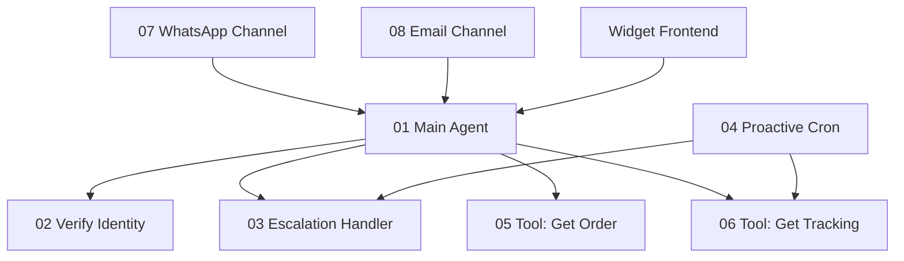

# Workflowy n8n

Osiem workflowów gotowych do importu. Kolejność importu ma znaczenie: sub workflowy przed workflowami które ich wywołują.

## Kolejność importu

1. `05_tool_get_order.json`
2. `06_tool_get_tracking.json`
3. `02_verify_identity.json`
4. `03_escalation_handler.json`
5. `01_main_agent.json` (odwołuje się do 02, 03, 05, 06)
6. `04_proactive_delay_notifier.json` (odwołuje się do 03, 06)
7. `07_channel_whatsapp.json` (deleguje do 01)
8. `08_channel_email.json` (deleguje do 01)

Komenda: `make import` importuje wszystkie w tej kolejności.

## Mapa zależności



## Krótki opis każdego workflow

### 01. Main Agent

Główny workflow czatu. Trigger: webhook POST na `/webhook/wismo/chat`. 9 węzłów: webhook → normalize → PII redact → session load → LLM agent (Claude Sonnet 5) → guardrails validate → session save → audit log → respond.

### 02. Verify Identity

Sub workflow (Tool `verify_identity`). Fuzzy matching e-maila z tolerancją Levenshteina 2, dopasowanie 4 ostatnich cyfr telefonu jako fallback. Zwraca `verified: bool` plus `reason_code` (nigdy nie ujawnia zawartości bazy).

### 03. Escalation Handler

Sub workflow (Tool `create_escalation`). Buduje `escalation_id`, zapisuje do Postgres (tabela `escalations`), pushuje payload Slack Block Kit z 3 przyciskami akcji. Kolor pinu odpowiada priorytetowi (`High` czerwony, `Medium` bursztynowy, `Low` szary).

### 04. Proactive Delay Notifier

Cron co godzinę. Wykrywa opóźnienia przesyłek (36h+ bez skanu), wysyła proaktywne e-maile. Przy 60h+ eskaluje przez 03 z priorytetem Medium. Dodatkowa deflekcja 10 do 15 procent.

### 05. Tool Get Order

Sub workflow (Tool `get_order`). Wybór backendu Shopify albo BaseLinker przez parametr `backend`. Normalizacja odpowiedzi do wspólnego formatu wewnętrznego, żeby agent LLM widział to samo niezależnie od źródła.

### 06. Tool Get Tracking

Sub workflow (Tool `get_tracking`). Auto detekcja przewoźnika po formacie numeru: InPost (24 cyfry zaczynające się od 6), DPD (14 cyfr od 0 lub 5), DHL (10 cyfr), Poczta Polska (LL9999999999PL), FedEx (12 cyfr), UPS (1Z...). Normalizacja do wspólnego schematu: `status`, `last_scan_datetime`, `last_scan_location`, `estimated_delivery`, `history`.

### 07. Channel WhatsApp

Odbiornik Twilio WhatsApp Business API. Session id = numer telefonu (TTL 24h, Meta session window). Formatter markdown → WhatsApp (obsługuje tylko `*bold*`, `_italic_`, `~strike~`). Detektuje sytuacje z propozycją akcji i generuje Interactive Buttons (Powiadom SMS, Konsultant, Dziękuję).

### 08. Channel Email

IMAP polling co minutę (tylko UNSEEN). Parser tresci usuwa cytaty i sygnatury, ekstrahuje numer zamówienia z tematu i treści. Custom nagłówek `X-WISMO-Session` do trackowania wątków. Wysyłka HTML z sygnaturą sklepu.

## Credentials do skonfigurowania w n8n po imporcie

1. **Anthropic API** (`01` Agent LLM).
2. **Postgres** (`01`, `03`, `04` Audit Log, Escalations, Fetch Active Orders).
3. **Redis** (`01` Load, Save Session).
4. **Shopify Admin** (`02`, `05`).
5. **BaseLinker** opcjonalnie (`05`).
6. **InPost API** (`06`).
7. **DPD API** opcjonalnie (`06`).
8. **DHL API** opcjonalnie (`06`).
9. **Poczta API** opcjonalnie (`06`).
10. **Twilio HTTP Basic** (`07`, sid i token jako user/pass).
11. **SMTP** (`04`, `08`).
12. **IMAP** (`08`).

## Environment variables (w n8n Settings → Variables lub `docker/.env`)

```
SHOPIFY_STORE=mojsklep.myshopify.com
SHOPIFY_ADMIN_TOKEN=shpat_...
BASELINKER_TOKEN=
INPOST_API_TOKEN=
INPOST_BASE_URL=https://api-shipx-pl.easypack24.net/v1
DHL_API_KEY=
POCZTA_API_TOKEN=
TWILIO_ACCOUNT_SID=
TWILIO_AUTH_TOKEN=
WHATSAPP_NUMBER=whatsapp:+48...
SLACK_ESCALATION_WEBHOOK=https://hooks.slack.com/services/...
SUPPORT_EMAIL=support@mojsklep.pl
STORE_NAME=Mojsklep
```

## Refaktor 01 do korzystania z sub workflowów

Główny workflow `01_main_agent.json` obecnie ma inline call do wismo-api dla guardraili i sesji. Po zaimportowaniu 02, 03, 05, 06 warto przejść do UI n8n i dodać w Agent LLM node te sub workflowy jako Tools. W konfiguracji Agent Node w n8n wskazujesz Workflow Tools i wybierasz każdy z 4 sub workflowów, plus definiujesz JSON Schema dla ich inputów (patrz `docs/SPECYFIKACJA.md` sekcja C.2).

## Eksport do repo po zmianach

```bash
docker compose exec n8n n8n export:workflow --all --output=/workflows/export.json
# potem rozpakuj do osobnych plików z .name z JSONa
```

Dobra praktyka: eksport po każdej istotnej zmianie w UI, żeby uniknąć driftu między produkcją a repo.
